<div align="center">

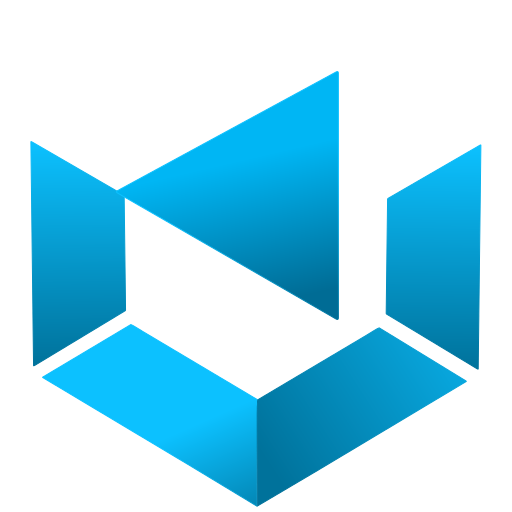

# ZUNOX 3D

**Sistema de gestión de pedidos para un emprendimiento de impresión 3D**
Catálogo público, panel de administración, seguimiento para el cliente y avisos por mail.


[**Ver el sitio en producción → zunox3d.com.ar**](https://zunox3d.com.ar)

</div>

<p align="center">
  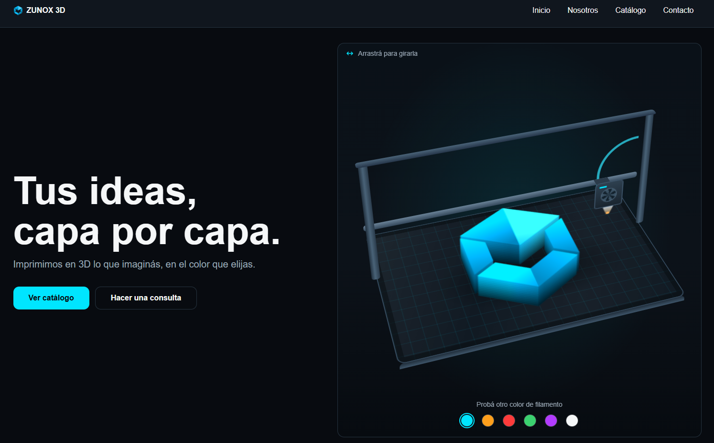
</p>

---

## Índice

1. [¿Qué es ZUNOX 3D?](#qué-es-zunox-3d)
2. [El equipo](#el-equipo)
3. [Qué puede hacer el sistema](#qué-puede-hacer-el-sistema)
4. [Capturas](#capturas)
5. [Arquitectura](#arquitectura)
6. [Estructura del repositorio](#estructura-del-repositorio)
7. [Base de datos](#base-de-datos)
8. [API](#api)
9. [Seguridad](#seguridad)
10. [Tecnologías](#tecnologías)
11. [Infraestructura](#infraestructura)
12. [Adaptable a otros negocios](#adaptable-a-otros-negocios)
13. [Próximos pasos](#próximos-pasos)
14. [Derechos de uso](#derechos-de-uso)

---

## ¿Qué es ZUNOX 3D?

ZUNOX 3D es el sitio y el sistema interno de un emprendimiento de **impresión 3D a medida**: vasos, máscaras, piezas funcionales, accesorios, pochocleras, esculturas y llaveros.

Resuelve dos necesidades a la vez:

- **Para el cliente:** una página pública con el catálogo, un formulario de consulta que arma el mensaje de WhatsApp y un link personal para **seguir el estado de su pedido** sin tener que preguntar.
- **Para el negocio:** un panel privado para cargar clientes y pedidos, administrar el catálogo (productos y categorías), cambiar el estado de cada pedido y **avisar al cliente por mail** automáticamente.

Todo corre en un único servicio: la API en .NET sirve también las páginas, así que el sitio completo vive bajo un solo dominio.

## El equipo

Este proyecto lo desarrollamos **entre tres personas**, dentro de la cuenta de GitHub **TechIntoBios**. No es un trabajo individual: nos repartimos el trabajo, nos ayudamos cuando algo no salía y fuimos resolviendo problemas que no habíamos visto en clase.

Mucho de lo que usamos lo **aprendimos por nuestra cuenta**: seguridad de sesiones, despliegue con contenedores, envío de mails transaccionales, configuración de dominio y DNS, y organización del código. El resultado salió de combinar **lógica, criterio propio y herramientas de inteligencia artificial como apoyo**, revisando y entendiendo cada decisión en lugar de copiarla sin más.


## Qué puede hacer el sistema

### Sitio público

- Página de inicio con una **impresora 3D animada** que imprime el nombre y el logo, se puede girar y cambia de color de filamento.
- **Catálogo por categorías** con fotos que se deslizan solas; cada categoría abre un detalle con botón directo a WhatsApp.
- **Formulario de consulta** que arma el mensaje y abre WhatsApp (no guarda datos).
- Diseño **adaptable a celular, tableta y escritorio**.
- **Política de privacidad** alineada con la Ley 25.326 de protección de datos personales.

### Seguimiento para el cliente

- Cada pedido tiene un **link único** (con un identificador imposible de adivinar).
- Muestra el estado, el detalle, el total y las observaciones del negocio.
- Los datos personales se muestran **parcialmente ocultos** (por ejemplo, teléfono `******8888`).

### Panel de administración (requiere iniciar sesión)

- **Nuevo pedido:** busca al cliente por teléfono (o lo crea), elige productos y cantidades, y guarda todo junto.
- **Productos y categorías:** alta, edición, activar y desactivar.
- **Seguimiento:** busca los pedidos de un cliente, cambia el estado (pendiente, realizado, cancelado), escribe una observación y edita los datos de contacto.
- **Aviso por mail** al cliente cuando cambia el estado de su pedido.

## Capturas

| Inicio | Catálogo |
|:---:|:---:|
|  | 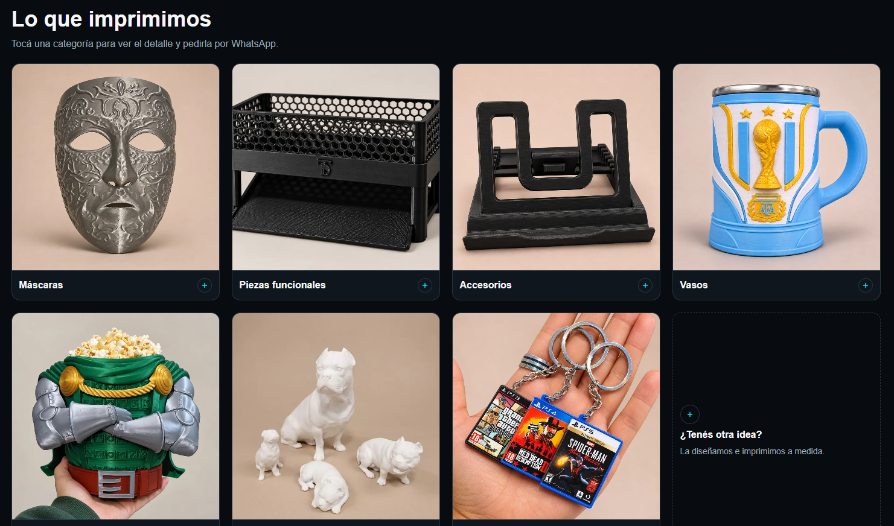 |

| Ingreso al panel | Nuevo pedido |
|:---:|:---:|
| 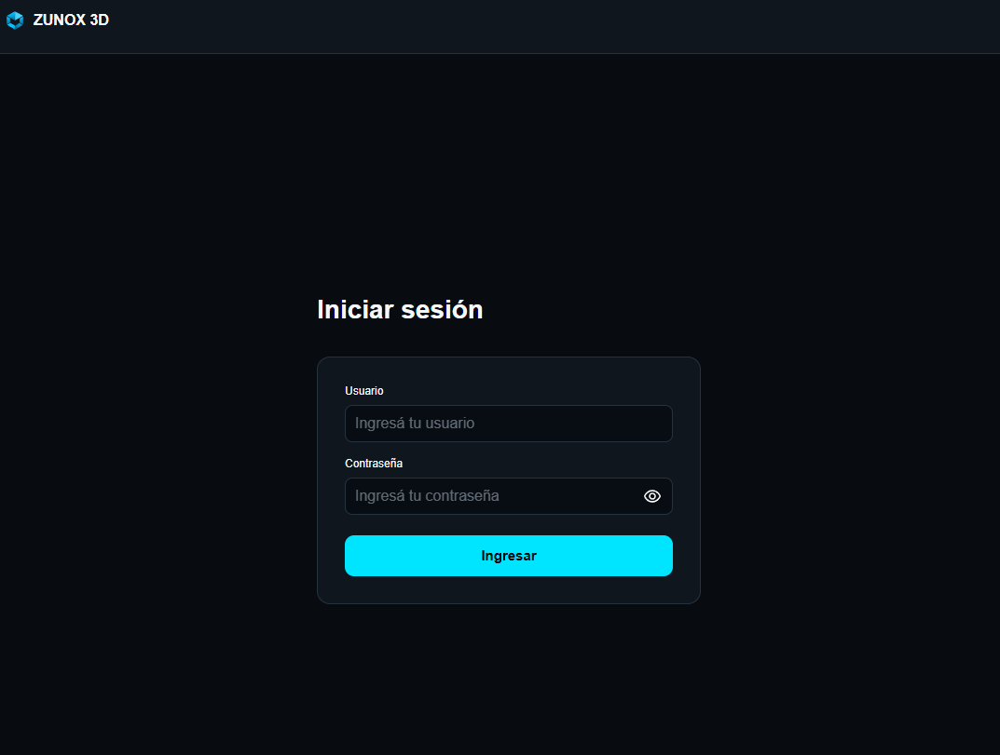 | 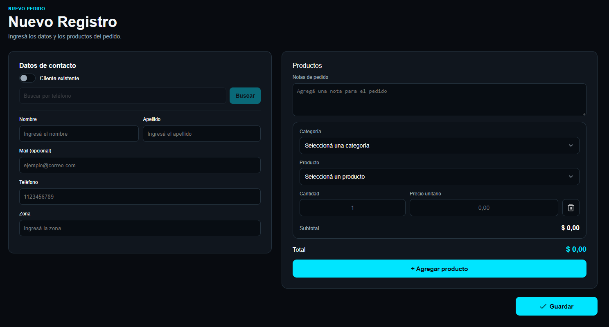 |

| Productos y categorías | Seguimiento (administración) |
|:---:|:---:|
| 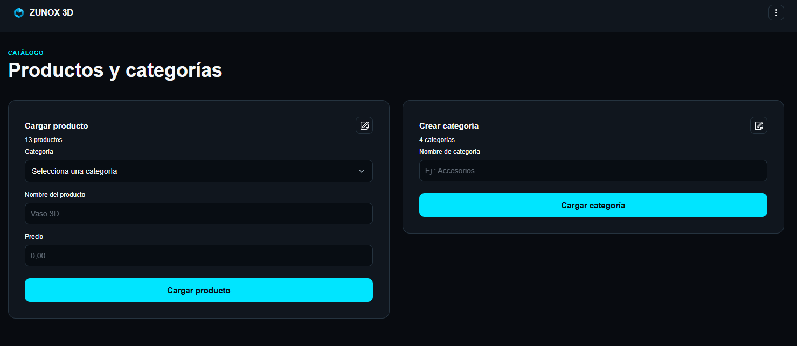 | 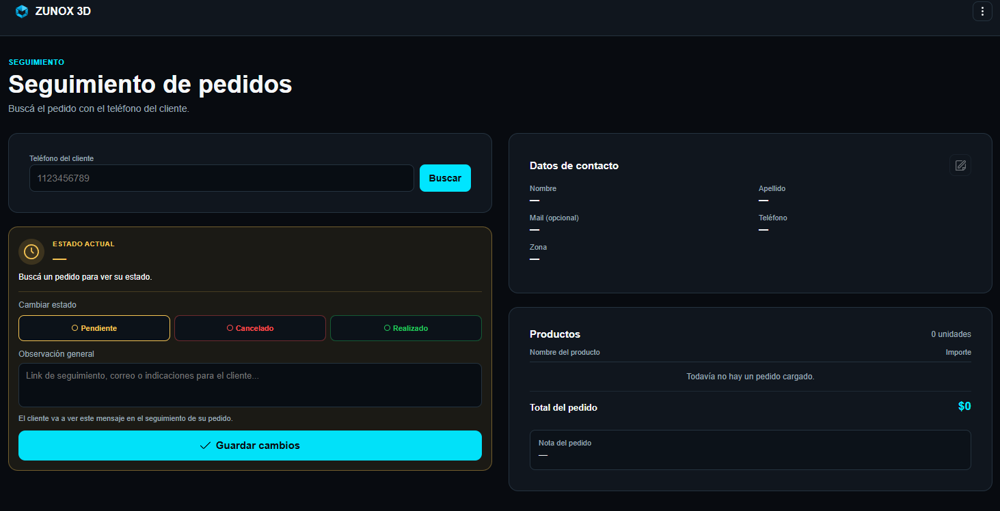 |

| Seguimiento (vista del cliente) | Mail de aviso |
|:---:|:---:|
| 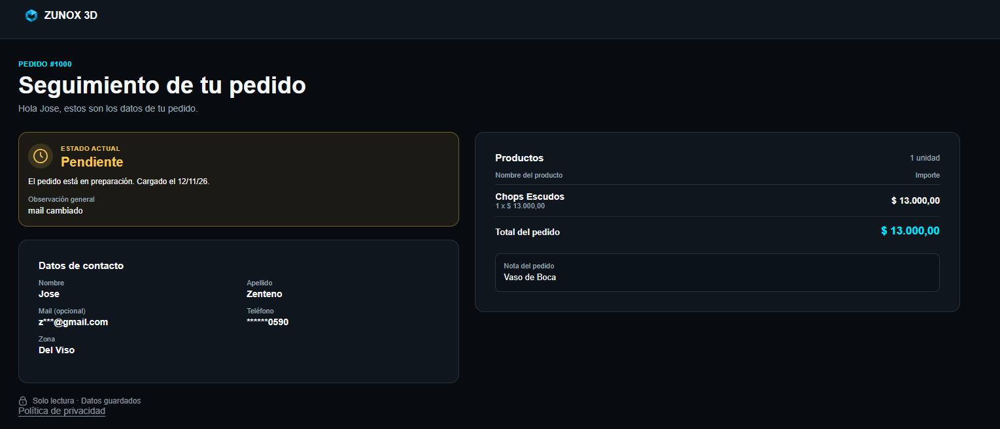 | 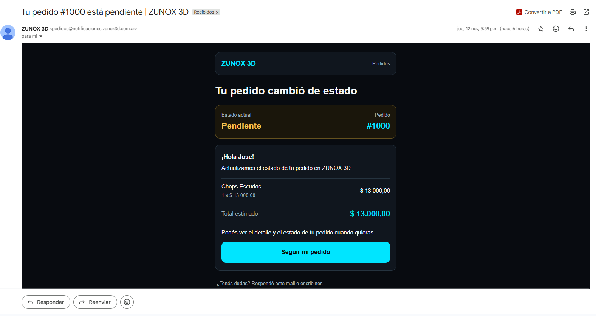 |

<p align="center">
  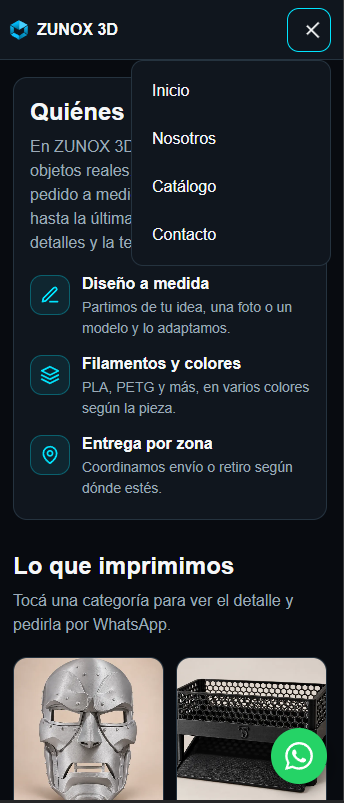
</p>

## Arquitectura

### Recorrido de un pedido

<p align="center">
  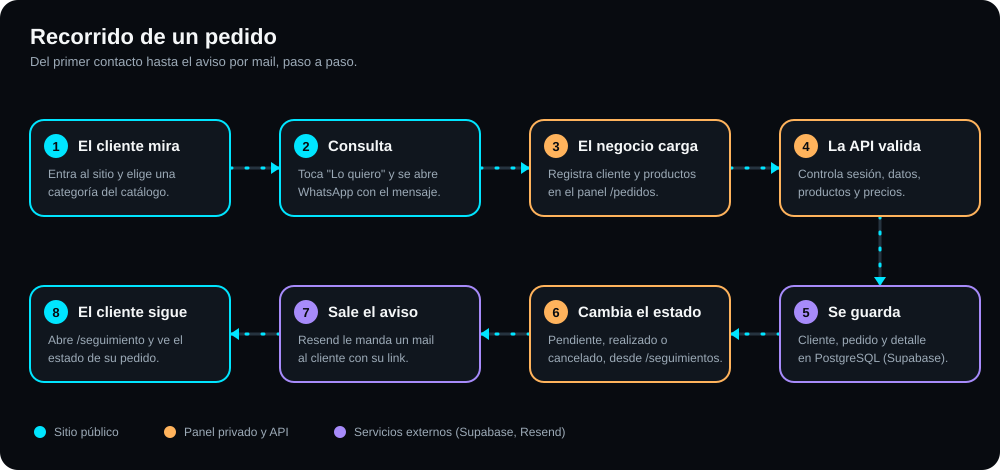
</p>

### Cómo se conectan los servicios

Un solo servicio en Render sirve las páginas y la API. La base de datos está en Supabase y los mails salen por Resend.

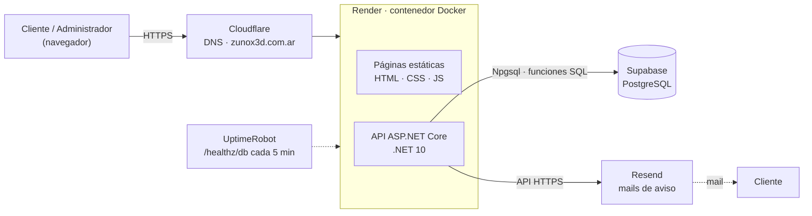

### Capas del backend

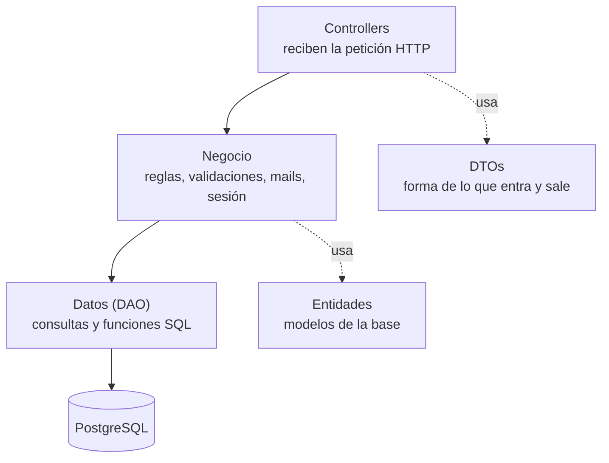

**Un pedido de punta a punta**

1. El administrador carga el pedido en `/pedidos`.
2. `ComprasController` lo recibe y `NegocioCompras` valida productos, cantidades y precios.
3. La base guarda cliente, pedido y detalle en una sola operación.
4. El cliente recibe su **link de seguimiento** y puede abrirlo en `/seguimiento`.
5. Cuando el administrador cambia el estado, `NegocioPedidos` lo guarda y `NegocioMail` envía el aviso por Resend.

## Estructura del repositorio

```text
Gestion-3D/
├── backend/                       API en ASP.NET Core (.NET 10)
│   ├── Program.cs                 Arranque: sesión, límites, cabeceras, archivos estáticos
│   ├── Dockerfile                 Imagen que usa Render (API + frontend)
│   ├── Controllers/               Puertas de entrada HTTP
│   │   ├── AuthController.cs          Login, logout y sesión
│   │   ├── ClientesController.cs      Buscar y editar clientes
│   │   ├── PedidosController.cs       Seguimiento, vista pública y cambio de estado
│   │   ├── ComprasController.cs       Guardar un pedido completo
│   │   ├── ProductosController.cs     Catálogo de productos
│   │   ├── CategoriasController.cs    Categorías
│   │   ├── EstadoPedidoController.cs  Estados disponibles
│   │   └── FiltroErroresNegocio.cs    Convierte errores de negocio en 400/404/409
│   ├── Negocio/                   Reglas del sistema
│   │   ├── NegocioPedidos / NegocioCompras / NegocioClientes ...
│   │   ├── NegocioMail.cs             Mails de aviso (Resend)
│   │   ├── NegocioJwt.cs              Creación y validación de la sesión
│   │   ├── NegocioProteccionLogin.cs  Bloqueo por intentos fallidos
│   │   ├── NegocioCabecerasSeguridad.cs  CSP, HSTS y otras cabeceras
│   │   ├── NegocioRutasPaginas.cs     Direcciones sin ".html"
│   │   └── NegocioValidaciones.cs     Validaciones comunes
│   ├── Datos/                     Acceso a PostgreSQL (un DAO por tabla)
│   ├── DTOs/                      Objetos de entrada y salida de la API
│   └── Entidades/                 Modelos de la base
│
├── frontend/                      Sitio y paneles (sin framework)
│   ├── index.html                 Inicio público
│   ├── login.html                 Ingreso             → /ingresar
│   ├── admin.html                 Nuevo pedido        → /pedidos
│   ├── products.html              Catálogo            → /productos
│   ├── tracking-admin.html        Seguimiento admin   → /seguimientos
│   ├── tracking.html              Seguimiento cliente → /seguimiento?id=...
│   ├── privacidad.html            Política de privacidad
│   ├── Css/                       Estilos (index, estilos, login)
│   ├── JavaScript/                Lógica de cada página
│   ├── Iconos/                    Iconos y logo en SVG
│   └── imagenes/                  Fotos del catálogo en WebP
│
├── docs/imagenes/                 Capturas que usa este README
├── .dockerignore                  Qué NO entra a la imagen de Docker
└── README.md
```

> Los scripts de la base de datos se mantienen **fuera del repositorio** (carpeta `db/` ignorada por git). La estructura se describe en la siguiente sección.

## Base de datos

PostgreSQL, alojada en Supabase. Tiene **7 tablas** y la lógica de escritura vive en **funciones SQL** (`fn_AgregarPedido`, `fn_ActualizarEstadoPedido`, etc.), que la API llama desde C#.

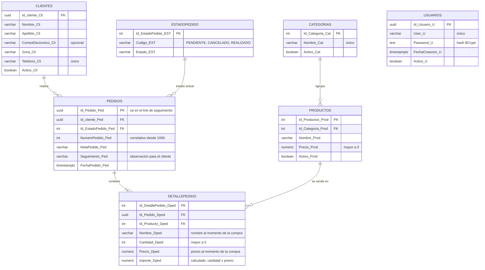

**Decisiones de diseño que vale la pena mencionar**

- **El teléfono identifica al cliente:** si vuelve a pedir con el mismo número, se reutiliza el registro.
- **El identificador del pedido es un UUID** al azar (lo que va en el link), y el **número de pedido** que ve la gente es correlativo y empieza en 1000.
- **El detalle guarda una copia** del nombre y del precio del producto en el momento de la compra, así cambiar un precio después no altera los pedidos viejos.
- **El importe se calcula en la base** (`cantidad × precio`), no se envía desde afuera.
- **Nada se borra:** clientes, productos y categorías se **desactivan**, para no perder el historial.
- **`Usuarios`** no tiene relación con las demás tablas: guarda solo quién puede entrar al panel, con la contraseña cifrada con BCrypt.

## API

Todas las rutas empiezan con `/api`. Salvo las marcadas como públicas, exigen sesión iniciada.

| Área | Método y ruta | Acceso | Qué hace |
|---|---|:---:|---|
| Sesión | `POST /Auth/login` | público | Inicia sesión (cookie segura) |
| | `POST /Auth/logout` | público | Cierra la sesión |
| | `GET /Auth/sesion` | sesión | Indica si la sesión sigue activa |
| Clientes | `GET /Clientes/por_telefono/{telefono}` | sesión | Busca un cliente |
| | `PUT /Clientes/{id}` | sesión | Edita los datos de contacto |
| Pedidos | `GET /Pedidos/por_telefono/{telefono}` | sesión | Pedidos de un cliente |
| | `PUT /Pedidos/{id}/estado` | sesión | Cambia el estado y avisa por mail |
| | `GET /Pedidos/publico/{id}` | **público** | Seguimiento del cliente (datos parcialmente ocultos) |
| Compras | `POST /Compras/guardar` | sesión | Guarda cliente, pedido y detalle juntos |
| Productos | `GET /Productos/listar_productos` | sesión | Lista el catálogo |
| | `POST /Productos/Agregar` · `PUT /Productos/{id}` | sesión | Alta y edición |
| Categorías | `GET /Categorias/listar_Categorias` | sesión | Lista las categorías |
| | `POST /Categorias/agregar_Categorias` · `PUT /Categorias/{id}` | sesión | Alta y edición |
| Estados | `GET /EstadoPedido/estados` | sesión | Estados posibles |
| Salud | `GET /healthz` · `GET /healthz/db` | público | Estado del servicio y de la base |

**Direcciones de las páginas**

| Página | Dirección |
|---|---|
| Inicio | `/` |
| Ingreso | `/ingresar` |
| Nuevo pedido | `/pedidos` |
| Productos | `/productos` |
| Seguimiento (administración) | `/seguimientos` |
| Seguimiento (cliente) | `/seguimiento?id=…` |
| Privacidad | `/privacidad` |

## Seguridad

Pensamos la seguridad desde el principio, porque el sistema guarda datos personales de clientes.

- **Sesión con JWT en una cookie `HttpOnly`, `Secure` y `SameSite=Strict`** (nombre `__Host-…`): el JavaScript de la página no puede leerla.
- **Contraseñas cifradas con BCrypt**; nunca se guardan en texto plano.
- **Protección contra fuerza bruta:** tras 10 intentos fallidos, se bloquea ese usuario desde esa IP durante 15 minutos, además de un límite de pedidos por minuto.
- **Acceso cerrado por defecto:** toda ruta exige sesión salvo las marcadas como públicas.
- **Cabeceras de seguridad:** política de contenido estricta (CSP: solo recursos propios), `HSTS`, `X-Frame-Options`, `nosniff`, entre otras.
- **Paneles fuera de Google:** las páginas privadas y el seguimiento de cada cliente no se indexan.
- **Seguimiento público con datos ocultos:** el link usa un UUID al azar y muestra el teléfono y el mail parcialmente tapados.
- **Sin secretos en el código:** claves, contraseñas y cadena de conexión viven en variables de entorno, nunca en el repositorio.
- **Consultas parametrizadas:** los datos del usuario nunca se pegan dentro del SQL.
- **Base de datos protegida:** acceso restringido a la API, con seguridad a nivel de fila activada en Supabase.

## Tecnologías

| Capa | Tecnología |
|---|---|
| Backend | C# · ASP.NET Core (.NET 10) |
| Acceso a datos | Npgsql (PostgreSQL) con funciones SQL |
| Base de datos | PostgreSQL en Supabase |
| Autenticación | JWT (cookie `HttpOnly`) y BCrypt |
| Frontend | HTML, CSS y JavaScript puro, sin frameworks |
| Mails | Resend |
| Contenedor | Docker |
| Hosting | Render |
| Dominio y DNS | NIC.ar y Cloudflare |
| Monitoreo | UptimeRobot |

## Infraestructura

El sitio funciona como **un único servicio en la nube**, con cada pieza en el proveedor que mejor le calza:

| Pieza | Servicio |
|---|---|
| Aplicación (API y páginas) | Contenedor Docker en Render |
| Base de datos | PostgreSQL en Supabase |
| Mails de aviso | Resend |
| Dominio | NIC.ar, con DNS en Cloudflare |
| Monitoreo | UptimeRobot |

Las claves y datos de conexión se guardan como variables de entorno del servicio, nunca dentro del código ni del repositorio.

## Adaptable a otros negocios

ZUNOX 3D se hizo para un emprendimiento puntual, pero la base es **reutilizable**: un catálogo con categorías, clientes, pedidos con estados, seguimiento para el cliente y avisos por mail sirven igual para cualquier negocio que venda productos a pedido. Con el mismo sistema se puede armar la versión de otra persona o marca cambiando el catálogo, los textos, los colores y los datos de contacto.

Si te interesa algo así para tu negocio, escribinos.

## Próximos pasos

- Pruebas automáticas del backend.
- Botón para **reenviar el mail de aviso** desde el seguimiento de administración.
- Cambio de contraseña desde el panel y soporte para varios usuarios.
- Páginas `404`, `robots.txt` y `favicon.ico`.
- Vista previa al compartir el link por WhatsApp (Open Graph).

## Derechos de uso

El código se publica **para mostrar cómo está hecho el proyecto y cómo funciona**. No incluye la configuración, las claves ni los scripts de la base de datos, y no está pensado para instalarse ni ponerse en marcha por cuenta de terceros.

© TechIntoBios. **Todos los derechos reservados.**

---

<div align="center">

Hecho por el equipo de **TechIntoBios** · Impresión 3D a medida

</div>
